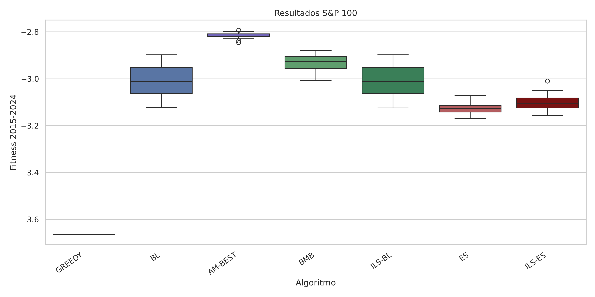

# Portfolio optimization with metaheuristics

Choosing stock weights for the IBEX 35, S&P 100 and S&P 500 with 14 algorithm configurations, from a greedy baseline to genetic, memetic, multi-start, ILS, simulated annealing and GRASP. Written in C++ for the Metaheuristics course (University of Granada, 2026), in three stages: trajectory search (P1), population-based search (P2) and multi-start / hybrid methods (P3).



## Problem

Each solution is a weight vector **w** over the assets of an index. A weight is either 0 or between `lo` and `hi` (0.005–0.08 for IBEX 35, 0.005–0.05 for S&P 100, 0.005–0.02 for S&P 500), and the weights add up to 1; a repair operator keeps every candidate feasible.

```
fitness(w) = Σᵢ wᵢ · Σₜ log(1 + rₜᵢ)  −  λ · sqrt(wᵀ Σ w)        λ = 500
```

The first term is the accumulated log-return, the second penalizes portfolio volatility (Σ is the covariance of daily returns). Weights are fitted on daily returns from **2015–2024** and then evaluated, without changes, on **2025**.

## Results

50 independent runs per algorithm and dataset, 10,000 fitness evaluations each, seeds recorded in `resultados/semillas_utilizadas.csv`. Mean fitness (higher is better):

| Algorithm | IBEX 35 train | IBEX 35 2025 | S&P 100 train | S&P 100 2025 | S&P 500 train | S&P 500 2025 |
|---|---:|---:|---:|---:|---:|---:|
| AM-Best (memetic) | **−4.490** | −3.083 | **−2.814** | **−3.741** | −2.734 | **−3.870** |
| GRASP | −4.491 | **−3.080** | −2.863 | −3.794 | **−2.726** | −3.997 |
| Multi-start (BMB) | −4.548 | −3.102 | −2.932 | −3.825 | −3.030 | −4.045 |
| ILS + local search | −4.576 | −3.108 | −3.006 | −3.858 | −3.145 | −4.098 |
| Local search (BL) | −4.577 | −3.110 | −3.007 | −3.862 | −3.117 | −4.117 |
| Simulated annealing (ES) | −4.599 | −3.116 | −3.127 | −3.905 | −3.625 | −4.443 |
| Greedy | −4.650 | −3.387 | −3.664 | −5.020 | −3.438 | −5.205 |
| Random search | −4.913 | −3.291 | −3.406 | −4.176 | −3.637 | −4.406 |

The full table, with ILS and ILS-ES variants, evaluations and run times, is in `resultados/resultados_medias.csv`.

What the numbers say:

- The memetic algorithm (generational GA with BLX crossover plus a short local search on the best individuals) is best or second best in every column.
- GRASP is right behind it, 3× faster on IBEX 35, and the most stable method on S&P 100 and S&P 500 (standard deviation across runs 0.011 vs 0.110 for plain local search on S&P 500). Starting local search from a greedy randomized construction pays off.
- Simulated annealing, alone or inside ILS, falls clearly behind on S&P 500, the largest search space.
- The greedy portfolio has the highest raw 2025 profit on IBEX 35 (11.5%) but one of the worst risk-adjusted scores, so a good fitness is not the same as the best return in one particular year.

Differences were checked with Wilcoxon signed-rank tests over the 50 runs (`resultados/wilcoxon.csv`); BMB and ILS-BL beat simulated annealing with p < 10⁻¹⁴ on all three datasets.

## Build and run

Requires CMake and a C++17 compiler; the plots need Python 3 with pandas, matplotlib, seaborn and scipy.

```sh
cmake -S . -B build -DCMAKE_BUILD_TYPE=Release
cmake --build build -j
./build/main config.txt      # run from the repository root; writes resultados/
./generar_graficas.sh        # figures into graficas/
```

`config.txt` sets λ, the number of runs, the evaluation budgets and the parameters of each method.

## Layout

```
src/, inc/     problem definition and one file per algorithm
common/        base framework provided by the course (solution, problem and RNG types)
main.cpp       experiment driver
scripts/       plots and statistical tests
resultados/    raw and summarised results
graficas/      figures
docs/          reports for P1, P2 and P3 (Spanish)
datos_portfolio_2526/   daily returns 2015–2025 provided with the assignment
```

Code comments and reports are in Spanish. The history of this repository follows the three deliveries: P1 (local search), P2 (genetic and memetic algorithms) and P3 (multi-start, ILS, simulated annealing and GRASP).
